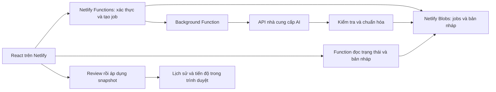

# Đề xuất tạo thực đơn tuần bằng AI trên Netlify

Ngày: 11/10/2026. Trạng thái: bản đề xuất để review; chưa triển khai.

## 1. Phạm vi khuyến nghị

MVP dành cho một gia đình: tạo bản nháp theo yêu cầu, xem trước, đổi một bữa, rồi áp dụng cho tuần đã chọn. Giữ React/Vite và deploy Git trên Netlify. Thực đơn mới không yêu cầu build/deploy lại website.

Mặc định giữ 5 ngày, mỗi ngày trưa và tối, tổng 10 bữa như app hiện tại. Mở rộng 7 ngày/bữa sáng là phạm vi riêng vì types, validation và nhiều nhãn giao diện đang cố định 10 bữa.

AI phải tạo món chính, món phụ, nguyên liệu định lượng, sơ chế, bước nấu và thông tin bảo quản liên quan. Shopping list được tính bằng code từ nguyên liệu, không nhờ AI tạo một danh sách độc lập.

MVP tạo khi bấm nút. Giai đoạn sau có thể tự tạo bản nháp mỗi tuần; luôn cần người dùng áp dụng trước khi thay kế hoạch đang dùng.

## 2. Những điểm của app hiện tại cần sửa

- `source/src/types/index.ts`: một Plan đã chứa nguyên liệu, prep, steps, storage và thaw; có thể kế thừa cấu trúc này.
- `source/src/utils/index.ts`: gộp nguyên liệu theo tên + đơn vị; chỉ đổi tbsp sang tsp. Tên do AI viết khác nhau dễ làm tách cùng một nguyên liệu thành nhiều dòng.
- `scaleText()` hiện đổi khẩu phần dựa trên chuỗi `[300 g]`. Không phù hợp để kiểm tra tính nhất quán của dữ liệu AI.
- `source/src/containers/PreparationManagement/PrepDay/index.tsx`: một số hướng dẫn prep/bảo quản đang cố định theo lịch Chủ nhật và nhóm protein. Cần chuyển sang lịch và chính sách theo từng món.
- `applyPlan()` trong `source/src/hooks/usePlannerController.ts`: thay plan và reset tiến độ nhưng chưa gắn chặt việc áp dụng với tuần đích.
- `source/src/services/storageService.ts`: chỉ lưu một state trong trình duyệt; chưa có lịch sử tuần hay đồng bộ thiết bị.
- `source/src/validations/index.ts`: kiểm tra cấu trúc cơ bản, chưa kiểm tra tham chiếu nguyên liệu và phụ thuộc giữa prep với bước nấu.

## 3. Luồng sử dụng

1. Chọn tuần, số người, khẩu vị, món không thích, thành phần cần tránh, thiết bị, giới hạn thời gian nấu và thời gian có thể prep.
2. Có thể nhập nguyên liệu đang có bằng số lượng + đơn vị. Nếu chỉ tick “đã có”, hệ thống không được tự suy ra đủ cho cả tuần.
3. Bấm “Tạo thực đơn AI”. Server lưu yêu cầu thành job; giao diện hiển thị trạng thái, cho phép quay lại xem sau.
4. Xem bản nháp với các phần: thực đơn, nguyên liệu cần mua, lịch prep, bước nấu và việc cần làm trước mỗi bữa.
5. Đổi một bữa nếu cần. Tạo lại toàn bộ recipe bundle của bữa đó và tính lại những phần liên quan.
6. Bấm “Áp dụng cho tuần này”. Lưu bản cũ, áp dụng một snapshot đầy đủ và tạo checklist mới cho revision mới.
7. Khi AI lỗi, timeout, bị giới hạn hoặc bản nháp không hợp lệ: giữ nguyên kế hoạch đang dùng, hiện lý do và nút thử lại.

Đổi món sau khi đã mua hoặc prep phải hiện những nguyên liệu/thao tác bị ảnh hưởng. Không tự coi đồ đã chuẩn bị cho món cũ là sẵn sàng cho món mới.

## 4. Kiến trúc

- Functions và frontend nằm cùng repo, deploy cùng Netlify site. Giữ `base = source`, `publish = dist`, bổ sung thư mục functions.
- API key chỉ có ở môi trường server của Netlify, không dùng biến `VITE_*` và không trả về trình duyệt.
- Dùng Background Function cho tác vụ AI dài; frontend đọc trạng thái với khoảng chờ tăng dần. Không giữ một request trình duyệt mở trong suốt quá trình tạo.
- Netlify Blobs dùng site-wide store để job/bản nháp tồn tại qua deploy. Tách namespace production với preview để test không ghi vào dữ liệu thật.
- Đọc trạng thái job với strong consistency. Bản nháp lưu theo ID/revision riêng, không ghi đè lẫn nhau.
- MVP giữ lịch sử đã áp dụng và tiến độ ở trình duyệt, có export/import. Đăng nhập trên thiết bị khác có thể đọc bản nháp server nhưng chưa đồng bộ checklist; tính năng đồng bộ gia đình thuộc giai đoạn sau.
- Netlify Blobs không có transaction/concurrency control. Chống bấm lặp và dùng request ID giúp giảm trùng job, không bảo đảm gọi AI đúng một lần khi nhiều request tranh chấp. Nếu cần quota cứng, nhiều gia đình hoặc sửa đồng thời: dùng database có transaction thay vì tự làm lock bằng Blobs.

### API dự kiến

| Endpoint | Mục đích |
| --- | --- |
| `POST /api/session` | Xác thực quyền dùng cho gia đình |
| `POST /api/menu-jobs` | Kiểm tra input, tạo job và kích hoạt worker |
| `GET /api/menu-jobs/:id` | Trạng thái job và lỗi có thể xử lý |
| `GET /api/menu-drafts/:id` | Bản nháp đã qua kiểm tra |
| `POST /api/menu-drafts/:id/regenerate-meal` | Tạo revision mới cho một bữa |

Background worker cũng phải kiểm tra quyền gọi nội bộ; không để endpoint worker trở thành đường vòng bỏ qua xác thực/quota. Mỗi lần gọi kiểm tra quyền truy cập job/draft, không chỉ dựa vào ID khó đoán.

MVP có thể dùng một mật khẩu gia đình, hash trên server, session cookie HttpOnly/Secure/SameSite qua thư viện đã được kiểm chứng. Thêm giới hạn thử đăng nhập, giới hạn tốc độ gọi AI và kiểm tra nguồn request thay đổi dữ liệu. Đây chưa phải hệ thống tài khoản nhiều gia đình.

## 5. Dữ liệu và tính nhất quán

Nâng lên schema v2, có migration v1 để không mất dữ liệu hiện tại.

| Thành phần | Trường và ý nghĩa chính |
| --- | --- |
| Weekly plan | `id`, `weekStart`, `timezone`, `revision`, `baseServings`, `meals`, `generatedAt`, `preferencesSnapshot` |
| Meal | Slot ngày/bữa, món chính/phụ, thời gian dự kiến, các nguyên liệu, prep, steps |
| Ingredient | ID chuẩn, tên hiển thị, nhóm, lượng, đơn vị, trạng thái mua như thịt có xương/không xương |
| Prep task | ID ổn định, bữa liên quan, thời điểm thực hiện, tham chiếu nguyên liệu, dụng cụ/vật chứa, phụ thuộc |
| Cooking step | Nội dung hướng dẫn, tham chiếu nguyên liệu/định lượng và prep task, thời gian chờ/chủ động |
| Storage task | Loại thực phẩm, phương pháp bảo quản, thời điểm prep/sử dụng/rã đông, policy đã kiểm tra |
| Progress | Khóa theo `planId + revision + taskId`; không dùng lại checklist của revision khác |

Nguyên tắc: định lượng là dữ liệu có cấu trúc. UI render định lượng vào hướng dẫn từ cùng nguồn với shopping list; không để AI viết lại số lượng trong nhiều chuỗi độc lập.

- Server chuẩn hóa ID nguyên liệu theo danh mục; không gộp “tỏi” và “garlic” chỉ bằng phỏng đoán ở frontend.
- Cộng các đơn vị tương thích; không đổi ml sang g nếu không có quy tắc riêng cho nguyên liệu.
- Phân biệt phần mua và phần ăn được nếu công thức yêu cầu, tránh coi 300 g cá nguyên con là 300 g phi lê.
- Scale theo số người một lần; cả shopping, prep và cook dùng cùng hệ số.
- Prep chung chỉ gộp khi nguyên liệu, thao tác và yêu cầu bảo quản tương thích; vẫn phân bổ lượng về đúng bữa để không tính hai lần.
- Trừ đồ có sẵn chỉ khi có số lượng và đơn vị đủ tin cậy. “Đã mua” và “đang có” là hai trạng thái khác nhau.
- Dữ liệu giá ở MVP là ngân sách mục tiêu, chưa phải dự báo giá đi chợ chính xác. Cần nguồn giá nếu muốn kiểm tra ngân sách bằng tiền.

## 6. Pipeline AI và kiểm tra

1. Kiểm tra preferences, slot và giới hạn input trên server.
2. Tạo khung món dựa trên khẩu vị, thiết bị, thời gian, lịch sử gần đây và nguyên liệu có sẵn.
3. Sinh recipe bundle có cấu trúc cho từng bữa với concurrency giới hạn; cache kết quả từng phần để retry không phải tạo lại cả tuần.
4. Chuẩn hóa nguyên liệu và kiểm tra schema, các ID/tham chiếu, số lượng, đơn vị, khẩu phần, nguyên liệu được dùng trong prep/cook và phụ thuộc task.
5. Tính shopping list bằng code; sắp lịch prep dựa trên ngày ăn, thời gian prep và quy tắc bảo quản đã duyệt.
6. Đối chiếu thành phần cần tránh bằng danh mục, kể cả thành phần của gia vị. Trường hợp không xác định phải báo cần review, không tự kết luận an toàn.
7. Nếu sai: sửa riêng phần lỗi với số lần tối đa cấu hình, hết giới hạn thì job thất bại có giải thích.
8. Chỉ lưu bản nháp hoàn chỉnh vào trạng thái `ready`; không áp dụng dữ liệu từng phần vào plan đang dùng.

Structured output chỉ giúp đúng cấu trúc, không chứng minh công thức đúng hoặc an toàn. Quy tắc bảo quản dùng policy có nguồn chính thống và review riêng khi triển khai; AI không tự quyết định hạn dùng hoặc mức nhiệt an toàn. Thời gian nấu được ghi là ước tính, không thay thế kiểm tra độ chín.

Provider AI đi qua một adapter để đổi model/nhà cung cấp mà không đổi UI. Chưa chốt model hay giá trước khi đo chất lượng trên một bộ thực đơn mẫu.

## 7. Triển khai theo mốc

| Mốc | Công việc | Kết quả để review |
| --- | --- | --- |
| 1. Nền dữ liệu | Schema v2, migration, danh mục nguyên liệu tối thiểu, hàm tính shopping/scale, snapshot theo tuần/revision | Fixture tạo bằng tay thể hiện shopping–prep–cook nhất quán; backup v1 đọc được |
| 2. UI bản nháp | Form preferences, trạng thái job, preview, đổi bữa, áp dụng/khôi phục; dùng mock | Anh trải nghiệm toàn bộ luồng trước khi gọi AI trả phí |
| 3. AI trên Netlify | Session, Functions, worker, Blobs, adapter AI, validator, giới hạn gọi và logging | Tạo được bản nháp thật trên Deploy Preview; lỗi không làm mất plan |
| 4. Chất lượng và phát hành | Bộ test nghiệp vụ, thử chất lượng công thức, đo token/latency, kiểm tra policy, rollback | Báo cáo chất lượng/chi phí và bản preview để anh duyệt trước production |
| 5. Mở rộng | Tự tạo nháp hàng tuần, lịch sử cloud, nhiều thiết bị/gia đình, database nếu cần | Phạm vi riêng sau khi MVP ổn định |

Kiểm thử bắt buộc: lượng nguyên liệu cộng đúng; đổi khẩu phần đồng bộ; đổi một bữa không mang checklist cũ; áp dụng đúng tuần; migration/restore; job lỗi/timeout; endpoint không xác thực bị từ chối; người dùng không đọc được draft ngoài phạm vi; key không xuất hiện trong bundle/log.

Các mốc 1–2 có thể làm với mock khi môi trường chưa gọi được API. Trước mốc 3 cần khôi phục cài dependencies: lần kiểm tra trước npm registry của repo trả lỗi xác thực. Đây là điều kiện để chạy build/test/preview đáng tin cậy.

## 8. Tự tạo hằng tuần và chi phí

Sau MVP, Scheduled Function kích hoạt job tạo bản nháp, không tự áp dụng. Ví dụ 18:00 thứ Bảy giờ Việt Nam/Thái Lan tương ứng 11:00 UTC, cron `0 11 * * 6`. Scheduled Function chỉ khởi tạo tác vụ, worker làm phần dài. Lịch thật do anh chọn.

Chi phí gồm token tạo khung + chi tiết 10 bữa + sửa lỗi/đổi món, cộng Functions và storage theo plan Netlify. Không cần deploy lại cho mỗi thực đơn. Đo một nhóm tuần mẫu trước khi chốt ngân sách tháng; cấu hình trần output, retry, số lần tạo và lưu usage. Quota dựa trên Blobs là kiểm soát mức dùng cơ bản, không phải bộ đếm giao dịch bảo đảm trần cứng.

## 9. Các lựa chọn để anh review

Đề xuất mặc định: một gia đình; 10 bữa trưa/tối thứ Hai–thứ Sáu; tạo khi bấm nút; bản nháp cần áp dụng; ưu tiên món Việt và nguyên liệu dễ mua; Netlify Functions + Blobs; checklist vẫn lưu trên thiết bị ở MVP.

Cần chốt: 5 hay 7 ngày, có bữa sáng không; tạo bằng nút hay cần lịch tự động ngay; có cần đồng bộ checklist cho các thành viên ngay; sở thích và giới hạn ăn uống; provider/API account và ngân sách thử nghiệm.

## Nguồn nền tảng

- [Netlify Functions](https://docs.netlify.com/build/functions/overview/): triển khai backend cùng site.
- [Background Functions](https://docs.netlify.com/build/functions/background-functions/): xử lý dài, tối đa 15 phút theo tài liệu hiện tại.
- [Netlify Blobs](https://docs.netlify.com/build/data-and-storage/netlify-blobs/): site-wide storage, strong consistency và giới hạn last-write-wins.
- [Scheduled Functions](https://docs.netlify.com/build/functions/scheduled-functions/): lịch UTC, chỉ tự chạy trên published deploy.
- [Environment variables](https://docs.netlify.com/build/functions/environment-variables/): cấu hình key cho server qua Netlify UI/CLI/API.
